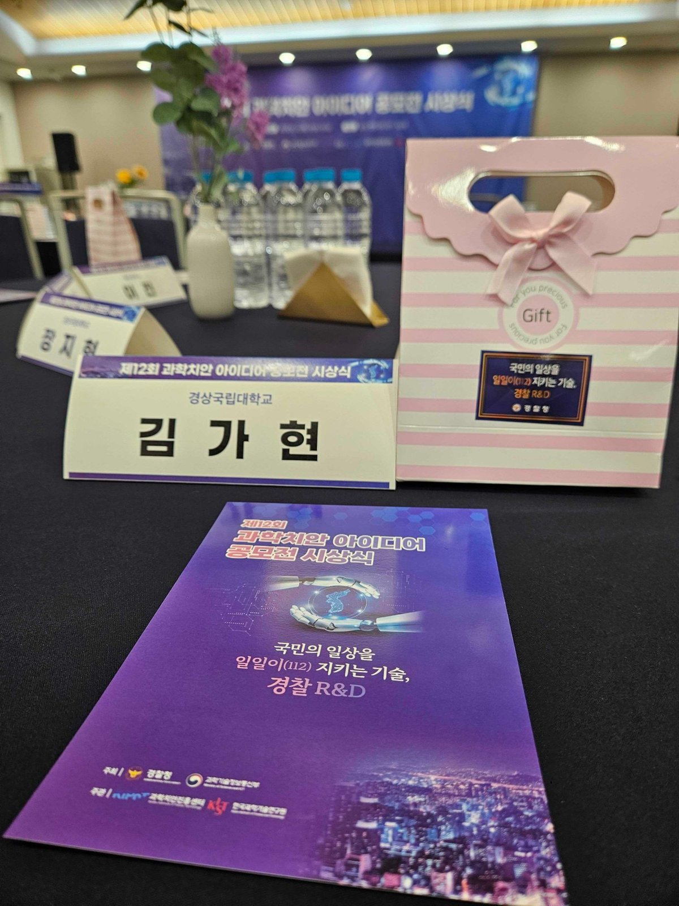

# 연구노트 — 진주시 무인순찰로봇 배치 세미 시뮬레이션 (준지도학습 기반 ABM · FDE)

| 항목 | 내용 |
|---|---|
| 일자 | 2026년 10월 22일 (목) |
| 시간 | 12:30 – 13:30 (60분) |
| 장소 | 송도컨벤시아, 인천광역시 연수구 |
| 계기 | 제12회 과학치안 아이디어 공모전 시상식 (주최: 경찰청·과학기술정보통신부 / 주관: 과학치안진흥센터·한국과학기술연구원) |
| 작성 | 김가현 (테크노베이션파트너스 · 경상국립대학교 졸업생) |
| 대상 지역 | 경상남도 진주시 — 경상국립대학교 소재지 (지구대 5 · 파출소 8, 도로 10m 구간 117,351개) |

*사진 메타데이터: Galaxy S23, 2026-10-22 12:15, 인천광역시 연수구.*

---

## 1. 주제

수상작(전국 경찰 순찰 안전지도)의 후속으로, **한 도시에 무인순찰로봇을 실제로 배치한다면 어디에·몇 대·한 번에 얼마나
오래** 돌려야 하는지를 진주시에 한정해 추정한다.

- **방법**: 준지도학습(그래프 레이블 전파) 위험장 위를 움직이는 로봇 행위자기반모형(ABM)
- **관점**: FDE(Forward Deployed Engineering) — 현장 레이블에서 출발하고, 배치·검증 계획까지 낸다
- **도메인**: 경상국립대 가좌캠퍼스 대학가, 남강 양안 구도심, 혁신도시, 읍면 지역

## 2. 진행 내용 (12:30–13:30)

1. **문제 재정의** — “전국 지도” 에서 “진주에 무엇을 배치할 수 있는가” 로 질문을 좁힘.
2. **현장 레이블 확인** — 원 파이프라인(실제 100m 인구 기반)이 진주에서 지정한 사각지대는 가좌동 대학가 1곳(29구간).
3. **대리변수 점검** — 공개 자료 대리수요로는 이 지점이 49백분위 → 대리변수 배치는 현장 지목 지점을 놓침.
4. **준지도학습 위험장** — 레이블 29 + 음성 표본 290을 도로망·특징 그래프로 전파, 20회 부트스트랩.
5. **ABM 시나리오** — 정책(HEU·SSL) × N ∈ {5,10,20}대 × T ∈ {60,120,240}분, 하루 2회, 시드 10개.
6. **배치 설계** — 이해관계자, 단계별 시범, 현장 레이블 순환, KPI, 점검표.

## 3. 핵심 관찰

- 10대 × 120분에서 위험 상위 5% 구간 주 1회 통과율: 휴리스틱 **2.4%** vs 준지도학습 **46.1%**.
- 휴리스틱은 20대 × 240분에서도 가좌동 사각지대를 **0회** 통과, 준지도학습은 10대부터 연 **529–901회**.
- 위험이 금산·하대·상대·개양에 흩어진 진주에서는 같은 로봇-시간이면 **대수 증가**가 유리(40 로봇-시간: 29% → 46% → 58%).
- 통계물리 점검: 로봇 1대의 고유 커버리지는 S(T) ∝ T^θ (θ ≈ 0.6–0.7)로 준선형 → 같은 예산이면 N·S(T)가 큰 쪽(대수 증가)이 유리하고, 이 효용은 위험 군집 수 n_c에서 끊김. N·S(T) 지수와 ABM 결과 순위상관 ρ = 0.97, 무작위 기지 null 대비 z = 8.9(단, 평가가 R에 의존하는 내부 일관성 검정).
- 위험장 R은 양 끝에 몰린 포화 점수이고 공간 구조 대부분이 특징 유사도에서 옴(도로망 단독 전파와 순위상관 0.07) → “레이블과 비슷한 구간”으로 해석.
- 진주의 첫 단계는 대규모 배치가 아니라 **가좌동 대학가 2대 × 12주 시범으로 현장 레이블을 모으는 일**.

## 4. 산출물

| 파일 | 내용 |
|---|---|
| [report.md](report.md) | 연구보고서 초안 (Markdown) |
| [report.html](report.html) | 연구보고서 초안 (GNU 템플릿 A4, 폰트·그림 내장) |
| [report.pdf](report.pdf) | 같은 내용 PDF |
| [figures/](figures/) | 그림 5종 + 현장 사진 (서명 이미지는 `figures/signature.png`로 두면 빌드 시 마지막 쪽에 삽입) |
| [sim/jinju_semi_sim.py](sim/jinju_semi_sim.py) | 진주 구간 추출·특징 재구성·휴리스틱 로봇 격자 |
| [sim/ssl_abm.py](sim/ssl_abm.py) | 준지도학습 위험장 + 정책 비교 ABM |
| [sim/statphys_checks.py](sim/statphys_checks.py) | 통계물리 점검: 위험장 포화, 그래프 분해, S(t) 스케일링, 무작위 기지 null |
| [sim/make_figures.py](sim/make_figures.py) | 그림 생성 |
| [sim/build_report.py](sim/build_report.py), [sim/paginate.mjs](sim/paginate.mjs) | GNU 템플릿 보고서 조판 |
| [results/](results/) | `ssl_abm_scenarios.csv`, `ssl_model.json`, `scenarios.csv`, `robot_sites.json` 등 |

보고서 양식: [GNU template](https://github.com/Gahyoun/gnu-network-science-skills/tree/main/templates/gnu-template)
(표지는 공식 서식형, 본문은 A4 테두리·하단 시그니처).

## 5. 다음 할 일

- [ ] 가좌동 대학가 현장 답사 — 보도·조도·충전 거점 점검표 작성
- [ ] 개양파출소와 주간 레이블 입력 방식 협의
- [ ] 경상국립대 학생 체감안전 설문 문항 초안
- [ ] 진주경찰서 본서 좌표, 진주시 CCTV 관제 연계 방식 확인
- [ ] 서명 이미지(`figures/signature.png`) 추가 후 보고서 재빌드
