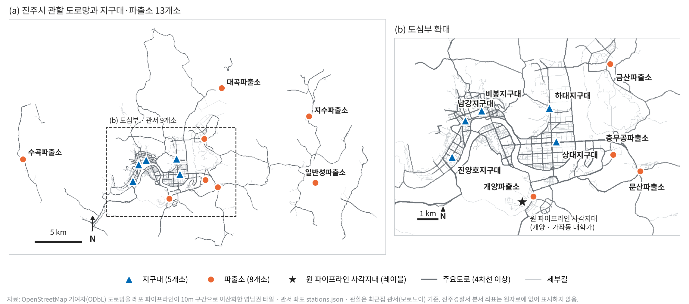
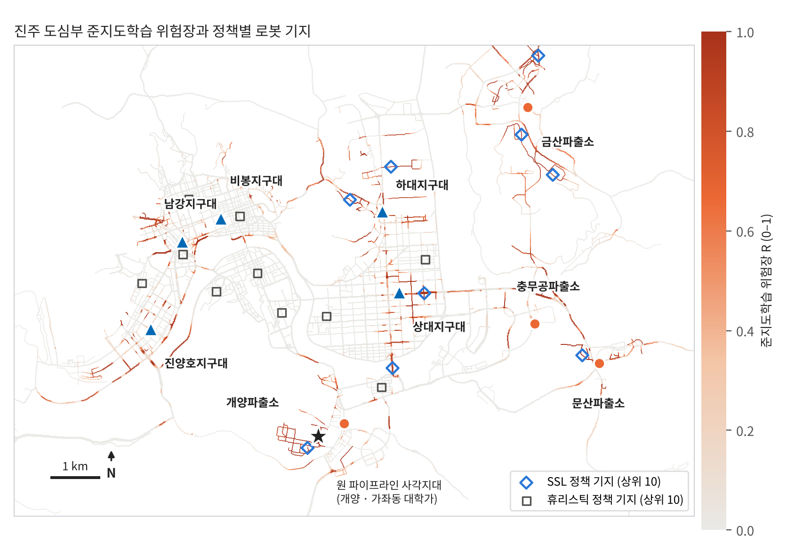
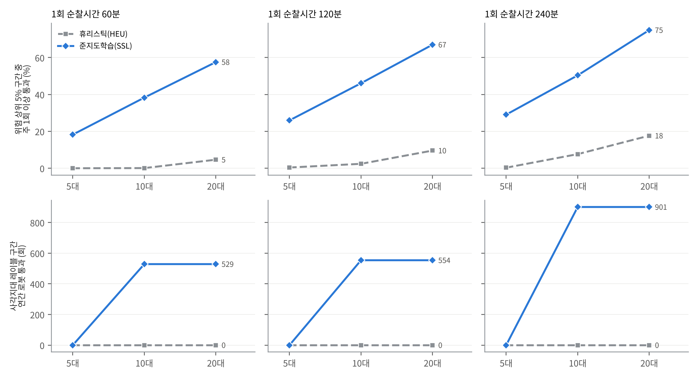
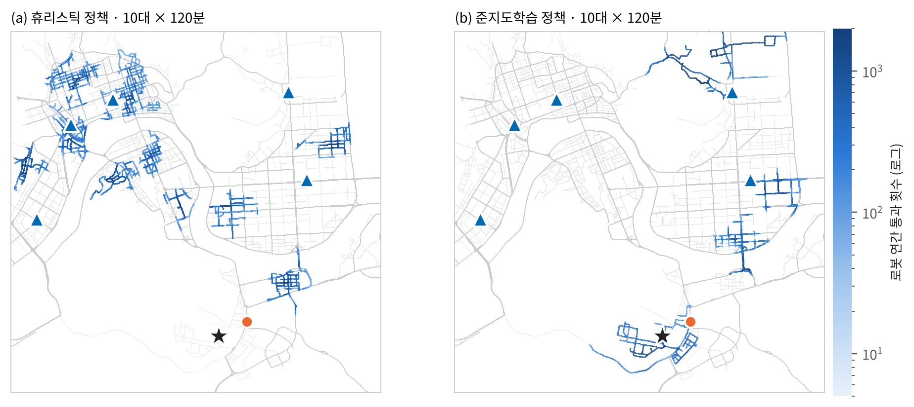

# 진주시 무인순찰로봇 배치 세미 시뮬레이션 — 준지도학습 기반 ABM과 현장 배치(FDE) 설계

**연구보고서 초안** · 경상국립대학교 소재지 진주 사례
연구일시: 2026. 10. 22.(목) 12:30–13:30 · 장소: 송도컨벤시아(인천광역시 연수구)
작성: 김가현 (테크노베이션파트너스 · 경상국립대학교 졸업생) · 초안 v0.2 (2026-10-26)

---

## 요약

경상국립대학교가 있는 경상남도 진주시(인구 335,939명, 2025년 말)를 대상으로, 무인순찰로봇을 어디에·몇 대·한 번에
얼마나 오래 돌릴지를 **준지도학습(semi-supervised) 위험장 위에서 움직이는 행위자기반모형(ABM)**으로 추정하고,
그 결과를 현장 배치 계획으로 옮겼다. 접근은 FDE(Forward Deployed Engineering) 방식, 즉 현장 운영자의 문제에서
출발해 작동하는 도구를 만들고 현장 피드백으로 고쳐 가는 방식을 따른다.

1. **현장 레이블은 하나뿐이었다.** 실제 100m 격자 인구를 쓴 원 파이프라인이 진주에서 사각지대로 지정한 곳은
   개양파출소 관할 가좌동 대학가(경상국립대 가좌캠퍼스 인접) 1개 지점, 29개 도로 구간이다. 이 지점은 공개 자료로
   만든 대리수요 우선도에서는 49백분위에 그쳐, **대리변수만 쓰는 휴리스틱 배치는 실제 사각지대를 놓친다.**
2. **준지도학습으로 레이블을 넓혔다.** 레이블 29구간과 보호가 두터운 구간 표본 290개를 도로망 인접·특징 유사도 그래프
   위에서 전파해 진주 전 구간(117,351개)의 위험장 R을 만들었다. 위험 상위 5% 구간의 97%는 레이블 지점에서 300m
   넘게 떨어진 곳(금산·하대·상대 등)으로, 레이블과 비슷한 조건을 가진 구간을 찾아냈다.
3. **정책 비교.** 같은 10대 × 120분(하루 2회)에서 위험 상위 5% 구간의 주 1회 이상 통과율은 휴리스틱 2.4% vs
   준지도학습 46.1%. 휴리스틱 정책은 20대를 넣어도 가좌동 사각지대를 한 번도 지나지 않았고, 준지도학습 정책은
   10대부터 연 529–901회 지났다.
4. **대수 vs 순찰시간.** 위험이 여러 곳에 흩어진 준지도학습 위험장에서는 같은 로봇-시간이면 **대수를 늘리는 편**이
   유리했다(하루 40 로봇-시간: 5대 × 240분 29% < 10대 × 120분 46% < 20대 × 60분 58%). 위험이 한 곳에 몰린
   경우(휴리스틱)는 반대로 순찰시간 연장이 유리했다. **배치 규모는 어떤 위험 지도를 믿느냐에 달려 있으므로 현장 검증이
   먼저다.**
5. **배치 제안.** 1단계로 가좌동 대학가에 2대를 12주 시범 운용하며 지구대 경찰관이 위험 구간 레이블을 매주 추가하고,
   위험장을 다시 학습해 2단계(금산·하대·상대 권역 확장)의 대수와 위치를 정한다.

---

## 1. 서론

### 1.1 배경

전국 경찰 순찰 안전지도는 지구대·파출소별 순찰경로 최적화와 가상순찰로 도로 구간별 연간 방문빈도를 산출한
결과물로, 제12회 과학치안 아이디어 공모전 우수상(KIST 원장상)을 받았다. 시상식 당일(2026. 10. 22.) 현장에서
후속 질문을 다음과 같이 정리하였다. “전국 지도를 만들었으니, 이제 한 도시에 실제로 무엇을 배치할 수 있는가.”

대상지는 작성자가 졸업한 경상국립대학교가 있는 진주시로 정했다. 작성자가 생활권을 알고 있어 현장 지식을 검증에
쓸 수 있고, 대학과 협력해 시범 운용을 설계하기 쉽다.

무인순찰로봇은 관악구(2021 규제특례 실증), 부천 지구대(2024), 성남 분당(2025), 전주천(2025, 자치경찰 공모 연계),
원주천, 고양(2026, 경기북부자치경찰위원회) 등에서 실증되었으나, 이번 조사에서 진주·경남의 실증 보도는 찾지 못했다.

### 1.2 목적

1. 진주의 지역 구조와 치안 인프라를 정리해 로봇 배치의 전제를 세운다.
2. 레이블이 극히 적은 상황에서 위험 구간을 추정하는 준지도학습 위험장을 만든다.
3. 위험장을 따르는 로봇 에이전트로 대수(N)·1회 순찰시간(T)·배치 정책을 비교한다.
4. 결과를 현장에서 실행할 수 있는 단계별 배치·검증 계획으로 옮긴다.

### 1.3 FDE 접근

FDE(Forward Deployed Engineering)는 엔지니어가 운영 현장에 들어가 실제 업무 흐름과 제약을 기준으로 문제를 다시
정의하고, 작동하는 도구를 빠르게 배치한 뒤 현장 피드백으로 반복 개선하는 방식이다. 본 연구에서는 다음으로 구체화했다.

| FDE 원칙 | 본 연구에서의 적용 |
|---|---|
| 운영자의 질문에서 출발 | “로봇 몇 대를 어디에, 몇 분씩” 을 결정 변수(N, T, 기지 위치)로 둔다 |
| 현장 레이블을 최우선 신호로 | 원 파이프라인 사각지대(가좌동)를 정답 레이블로 쓰고, 대리변수는 보조로만 쓴다 |
| 적은 레이블로 시작해 늘리기 | 준지도학습으로 시작하고, 지구대 경찰관이 매주 레이블을 추가하는 순환을 설계한다 |
| 실행 가능한 산출물 | 배치 지도, 단계별 계획, KPI, 현장 점검표를 함께 낸다 |
| 가정을 드러내기 | 모형이 정하지 못하는 것(로봇 1회 통과의 억제 효과 등)을 현장 측정 항목으로 넘긴다 |

---

## 2. 진주 도메인 지식

### 2.1 도시 구조



*그림 1. 진주시 OpenStreetMap 도로망과 지구대·파출소 위치. (a) 관할 전체, (b) 도심부 확대. ★는 원 파이프라인이
지정한 사각지대(개양·가좌동). 도로망은 OSM(ODbL)을 10m 구간으로 이산화한 레포 타일이며, 진주경찰서 본서 좌표는
원자료에 없어 표시하지 않았다.*

- **인구.** 2025년 말 335,939명, 그중 청년 83,527명(24.86%). 대학 도시로서 청년 비중이 높다.
- **남강이 도심을 가른다.** 도심부 관서 9개소가 남강 양안에 모여 있고, 지구대 5개소(비봉·상대·남강·진양호·하대)가
  모두 도심에 있다. 진주성·중앙시장 일대 구도심은 남강 북안에 있다.
- **대학가.** 경상국립대학교 가좌캠퍼스가 있는 가좌동은 개양로 일대에 원룸·투룸 등 1–2인 가구 주택이 많다.
  개양파출소가 이 생활권을 맡는다.
- **혁신도시.** 충무공동(충무공파출소 관할)은 공공기관 이전으로 조성된 신시가지다.
- **읍면.** 수곡·지수·일반성·대곡·금산 파출소는 넓은 농촌·외곽 지역을 맡는다.
- **행사.** 남강유등축제가 매년 10월 남강 일대에서 열려, 이 기간 남강변 보행 수요가 크게 는다.

### 2.2 치안 인프라

| 구분 | 내용 |
|---|---|
| 관서 | 지구대 5 · 파출소 8 (그림 1) |
| 도로 | 10m 구간 117,351개, 주요도로(4차선 이상) 52.4% |
| 방범시설 | CCTV·비상벨 5,893지점(레포 자료), 구간의 42%는 반경 100m 안 시설 0개 |
| 접근성 | 최근접 관서까지 순찰차 도달시간 중앙값 4.6분(30–45 km/h 가정) |

관서별 담당 구간 수는 비봉(24,439)·상대(18,635)가 가장 많고, 수곡(1,805)이 가장 적다. 도심 지구대는 도로가 촘촘한
구역을, 읍면 파출소는 넓지만 도로가 성긴 구역을 맡는다.

### 2.3 현장 레이블: 가좌동 대학가

원 파이프라인은 실제 100m 격자 인구(SGIS)와 순찰·시설 공급을 결합해 사각지대를 뽑는다. 진주에서 선정된 곳은
**개양파출소 관할 가좌동 1개 지점(29구간)** 이며, 해당 격자 인구 3,498명, 반경 내 CCTV·비상벨 0개였다. 경상국립대
가좌캠퍼스 인접 대학가로, 학생 1인 가구가 많고 야간 귀가 동선이 겹치는 생활권이다.

이 레이블은 공개 자료만으로 만든 대리수요(세부길 밀도) 우선도에서 **49백분위**에 머물렀다. 대리변수로 고른 로봇 기지
상위 10곳은 비봉·남강 등 구도심에 몰렸고 가좌동은 빠졌다. 공개 대리변수만으로 배치하면 현장이 지목한 곳을 놓친다는
뜻이며, 이것이 준지도학습을 도입한 이유다.

---

## 3. 문헌조사

### 3.1 순찰과 억제

| 주제 | 근거 | 로봇 배치에 주는 시사점 |
|---|---|---|
| 범죄의 공간 집중 | 도시 범죄는 소수 미시지점에 집중한다(Weisburd, 2015). | 균등 배치보다 위험 지점 선별이 먼저다. |
| 핫스팟 순찰 | 핫스팟 순찰은 처치지점 범죄를 유의하게 줄였다(Sherman & Weisburd, 1995; Braga 외, 2019). 무작위 차량 예방순찰은 효과가 확인되지 않았다(Kelling 외, 1974). | 로봇도 “어디에 머무르는가” 가 핵심이다. |
| 체류시간 | 핫스팟 체류 약 11–15분에서 잔여 억제가 최대(Koper, 1995). 12–16분 무작위 순회가 신고·범죄를 줄였다(Telep, Mitchell & Weisburd, 2014). | 1회 순찰시간 T는 체류·순회 설계와 함께 정해야 한다. |
| 도보·비경찰 순찰 | 도보순찰이 폭력범죄 핫스팟의 범죄를 줄였고(Ratcliffe 외, 2011), 제복 경비원의 지시순찰이 역사 범죄를 16% 줄였다(Ariel, Bland & Sutherland, 2017). | 경찰관이 아닌 가시적 보호자도 억제할 수 있다 → 로봇의 간접 근거. |
| 보호자 | 범죄는 동기화된 범죄자·적절한 표적·보호자 부재가 겹칠 때 발생한다(Cohen & Felson, 1979). | 로봇은 야간 대학가처럼 보호자가 드문 시공간을 채우는 수단이다. |

### 3.2 무인순찰로봇

- **국내 실증.** 관악구(2021, 규제특례: 운영 시간·장소 사전 공개, 촬영 범위 최소화 조건), 부천 중동·계남지구대
  주변(2024), 성남 서현역·판교역 등 4곳(2025), 전주천 심야 순찰(2025, 적외선·지능형 CCTV 탑재), 원주천, 고양
  ‘폴리봇’(2026, 제작비 1억 900만 원 보도), 국립부경대 캠퍼스 AI 순찰로봇 도입 사례가 있다. 2023년 말 개정
  「지능형 로봇 개발 및 보급 촉진법」 시행으로 실외 이동로봇의 보도 주행 근거가 마련되었다.
- **효과 근거.** 로봇 순찰의 범죄 억제 효과를 무작위·준실험으로 검증한 연구는 이번 조사에서 찾지 못했다. 따라서 본
  보고서는 로봇의 효과를 범죄 감소가 아니라 **위험 구간을 얼마나 자주 지나는가(노출)** 로 측정하고, 억제 효과는
  시범 운용에서 측정할 항목으로 남긴다.

### 3.3 준지도학습과 행위자기반모형

- **그래프 기반 준지도학습.** 레이블이 있는 소수 노드의 정보를 유사도 그래프를 따라 레이블 없는 노드로 퍼뜨린다
  (Zhu & Ghahramani, 2002; Zhou 외, 2004). 레이블 비율 불균형은 클래스 질량 정규화로 보정한다(Zhu, Ghahramani &
  Lafferty, 2003). 레이블이 극히 적은 치안 현장(지정 사각지대, 현장 경찰관의 판단)에 맞는다.
- **치안 ABM.** 행위자기반모형은 단순 국지 규칙을 따르는 다수 에이전트에서 거시 패턴이 생기는 과정을 모사하며
  (Bonabeau, 2002), 순찰·범죄의 시공간 동학 연구에 쓰여 왔다(Groff, 2007; Malleson, Heppenstall & See, 2010).

---

## 4. 방법

### 4.1 자료

| 자료 | 내용 |
|---|---|
| 도로 구간 | 레포 영남권 타일: 10m 구간 양 끝 좌표, 순찰·접근·시설 복합 점수 S, 주요도로 여부 |
| 방범시설 | CCTV·비상벨 좌표와 대수 |
| 관서 | 지구대·파출소 13개소 좌표 |
| 레이블 | 원 파이프라인 사각지대 목록 중 진주 29구간 |

진주 관할은 최근접 관서(보로노이) 기준으로 잘랐다. 구간 특징으로 S, 이를 역산한 순찰 노출 P, 관서 접근성 A,
반경 100m 시설 F, 반경 250m 세부길 밀도 D를 썼다(산식은 `sim/jinju_semi_sim.py`).

### 4.2 준지도학습 위험장

| 요소 | 설정 |
|---|---|
| 양성 레이블 | 원 파이프라인 사각지대 29구간 |
| 음성 레이블 | 보호가 두터운 구간(S ≥ 65, 반경 100m 시설 ≥ 1, 7,935구간)에서 290개 무작위 추출 |
| 레이블 없음 | 나머지 117,032구간 |
| 그래프 | 도로망 인접(끝점을 공유하는 구간) ∪ 특징공간 8-최근접 이웃. 가중치 exp(−‖Δx‖²), 특징은 표준화 |
| 전파 | F ← αSF + (1 − α)Y, α = 0.95, 300회 반복, 대칭 정규화(Zhou 외, 2004) + 클래스 질량 정규화 |
| 불확실성 | 음성 표본을 20회 다시 뽑아 평균(위험장 R)과 표준편차 |

### 4.3 로봇 에이전트

| 요소 | 설정 |
|---|---|
| 기지 선정 | 정책 점수 상위 구간부터, 기지 간 최소 900m 간격. N대면 상위 N개 |
| 이동 | 보행속도 4 km/h. 기지 반경 600m 밖은 지수적으로 억제, 같은 회차 재방문 회피, 되돌아가기 억제, 큰길보다 보도·세부길 선호 |
| 운용 | 하루 2회(야간 집중) × 365일, 시드 10개 앙상블 |
| 정책 HEU | 기지 = 대리 우선도 B 상위, 이동 선호 ∝ 0.2 + D + (1 − S/100) |
| 정책 SSL | 기지 = R × (1 − S/100) 상위, 이동 선호 ∝ 0.2 + 2R |
| 시나리오 | N ∈ {5, 10, 20}대 × T ∈ {60, 120, 240}분 × 2 정책 |

평가지표: ① 위험 상위 5% 구간 중 로봇이 주 1회 이상 지나는 비율, ② 레이블(가좌동) 구간 연간 로봇 통과 횟수,
③ 참고로 복합 점수 S의 진주 평균 변화.

---

## 5. 결과

### 5.1 준지도학습 위험장



*그림 2. 진주 도심부 준지도학습 위험장 R과 정책별 로봇 기지(각 상위 10). ★ 원 파이프라인 사각지대.*

- 레이블 구간은 위험장에서 99.9백분위에 있고, 음성 표본을 바꿨을 때 R의 표준편차는 평균 0.010으로 안정적이었다.
- 위험 상위 5% 구간의 97%가 레이블 지점에서 300m 넘게 떨어져 있다. 관할별 분포는 금산 18.3%, 하대 14.5%,
  개양 14.3%, 상대 13.2%, 남강 8.1%, 진양호 8.0%, 충무공 7.7% 순이다.
- 대리 우선도 상위 5%와 위험장 상위 5%는 하나도 겹치지 않았다. 두 지도는 서로 다른 곳을 가리킨다.
- SSL 기지 상위 10곳은 금산 4, 하대 2, 상대 2, 문산 1, 개양 1(9순위, 레이블에서 316m)이다. HEU 기지는 비봉 3,
  남강 3, 상대 2, 개양 1, 진양호 1로 구도심에 몰린다.

### 5.2 정책 × 대수 × 순찰시간



*그림 3. 1회 순찰시간(열)별로 대수(가로축)를 늘릴 때 위험 상위 5% 구간의 주 1회 이상 통과율(위)과 가좌동 레이블
구간의 연간 로봇 통과 횟수(아래).*

| 정책 | N | T(분) | 로봇-시간/일 | 위험 상위 5% 주 1회 통과 | 레이블 구간 연간 통과 | 진주 평균 S 변화(참고) |
|---|---:|---:|---:|---:|---:|---:|
| HEU | 5 | 240 | 40 | 0.3% | 0 | +1.9 |
| HEU | 10 | 120 | 40 | 2.4% | 0 | +2.4 |
| HEU | 20 | 60 | 40 | 4.6% | 0 | +2.2 |
| HEU | 20 | 120 | 80 | 9.6% | 0 | +3.9 |
| HEU | 20 | 240 | 160 | 17.7% | 0 | +6.3 |
| SSL | 5 | 240 | 40 | 29.1% | 0 | +0.9 |
| SSL | 10 | 120 | 40 | 46.1% | 554 | +1.2 |
| SSL | 20 | 60 | 40 | 57.5% | 529 | +1.4 |
| SSL | 10 | 240 | 80 | 50.4% | 901 | +1.7 |
| SSL | 20 | 120 | 80 | 67.0% | 554 | +2.2 |
| SSL | 20 | 240 | 160 | 74.9% | 901 | +3.5 |

전체 결과는 `results/ssl_abm_scenarios.csv`에 있다.

1. **표적 정확도.** 같은 대수·시간에서 SSL은 위험 상위 구간 통과율이 HEU보다 4배 이상(5–10대에서는 수십 배) 높았다. HEU는 20대 × 240분에서도
   가좌동 레이블 구간을 지나지 않았다.
2. **평균과 표적의 절충.** 진주 평균 S는 HEU가 더 많이 올랐다(10대 × 120분: +2.4 vs +1.2). HEU가 도로가 촘촘한
   구도심을 넓게 도는 반면 SSL은 위험 구간에 집중하기 때문이다. 평균 지표만 보면 잘못된 정책을 고를 수 있다.
3. **대수 vs 순찰시간.** SSL 위험이 금산·하대·상대·개양 등 여러 권역에 흩어져 있어, 같은 로봇-시간이면 대수를 늘리는
   편이 위험 구간을 더 많이 덮었다(하루 40 로봇-시간: 29% → 46% → 58%; 80 로봇-시간: 10대 × 240분 50% vs 20대 ×
   120분 67%). 반대로 위험이 구도심 몇 곳에 몰린 HEU 위험 지도에서는 순찰시간 연장이 유리했다(별도 실행,
   `results/scenarios.csv`). **최적의 N–T 조합은 위험의 공간 구조가 정한다.**
4. **레이블 지점 도달 조건.** 가좌동은 SSL 기지 9순위여서 N ≥ 10이어야 포함된다. 시범 운용에서는 이 지점을 기지로
   직접 지정하는 편이 낫다(6.2절).



*그림 4. 같은 10대 × 120분에서 로봇 연간 통과 분포. (a) HEU는 구도심, (b) SSL은 하대·상대·가좌동(★)을 돈다.*

---

## 6. 현장 배치 설계 (FDE)

### 6.1 이해관계자와 역할

| 주체 | 역할 | 본 연구가 제공하는 것 |
|---|---|---|
| 진주경찰서 · 개양파출소 등 지구대·파출소 | 운용 책임, 현장 레이블(위험 구간 판단), 이상 상황 출동 | 주간 위험 지도, 로봇 운행 요약, 레이블 입력 도구 |
| 경상남도자치경찰위원회 | 사업 기획·예산, 공모사업 연계 | 단계별 계획·KPI·비용 비교 근거 |
| 진주시 | CCTV 관제 연계, 보행환경 정비 | 로봇 경로상 보도·조명 개선 후보 목록 |
| 경상국립대학교 | 캠퍼스 인접 구역 협조, 학생 체감안전 조사, 연구 협력 | 대학가 시범 구역 설계, 설문 문항 |
| 로봇 운영사 | 기기·관제·유지보수 | 운행 로그 형식, 충전 거점 위치 |
| 학생·주민 | 이용자, 의견 제시 | 운행 시간·촬영 범위 사전 공개 |

### 6.2 단계별 배치

| 단계 | 기간 | 구역 | 규모 | 판단 기준 |
|---|---|---|---|---|
| 0. 현장 확인 | 2주 | 가좌동 대학가, SSL 상위 권역 답사 | — | 보도 폭·단차·경사, 야간 조도, 충전 거점, 통신 음영 점검표 완료 |
| 1. 시범 | 12주 | 가좌동 대학가(레이블 지점을 기지로 지정) | 2대 × 120–180분 × 야간 2회 | 운행 가동률, 레이블 구간 주간 통과, 체감안전 설문, 지구대 레이블 누적 |
| 2. 확장 | 12주 | 재학습한 위험장 상위 권역(현 시점 후보: 금산·하대·상대) | 대수는 위험 분산도로 결정(5.2절) | 위험 상위 5% 주 1회 통과율 목표치 대비 |
| 3. 행사 | 축제 기간 | 남강유등축제 남강변 | 기존 로봇 임시 재배치 | 인파 구간 이상 상황 탐지·전달 시간 |

시범 구역과 비교 구역은 위험장 점수가 비슷한 구역끼리 짝지어, 운용 시작 시점을 엇갈리게(stepped-wedge) 두면
전후 비교의 편향을 줄일 수 있다.

### 6.3 준지도학습 순환 (현장 레이블 → 재학습 → 재배치)

1. 지구대 경찰관이 주 1회, 지도에서 “위험” 또는 “안전” 구간을 표시한다(5분 이내 입력 목표).
2. 새 레이블을 더해 위험장을 다시 전파한다. 위험장 변화량과 레이블 수를 함께 기록한다.
3. 위험 상위 권역이 바뀌면 다음 주 기지·경로를 바꾼다. 기지 이동은 충전 거점 범위 안에서만 한다.
4. 레이블이 쌓이면 레이블 하나를 숨기고 다시 찾는지(교차검증)로 위험장의 예측력을 점검한다.

### 6.4 KPI

| 구분 | 지표 | 자료 |
|---|---|---|
| 운용 | 계획 대비 운행 가동률, 회차당 실제 순찰시간 | 로봇 운행 로그 |
| 노출 | 위험 상위 5% 구간 주 1회 이상 통과율, 레이블 구간 주간 통과 횟수 | 운행 로그 + 위험장 |
| 대응 | 이상 상황 탐지에서 지구대 전달까지 걸린 시간 | 관제 기록 |
| 결과 | 시범·비교 구역의 112 신고(생활안전) 전후 변화 | 경찰 자료(협조 필요) |
| 수용성 | 학생·주민 체감안전, 민원·개인정보 문의 건수 | 설문, 민원 기록 |

### 6.5 현장 점검표

- 보도 폭·단차·경사, 불법 주정차, 공사 구간(로봇 주행 가능 구간 확정)
- 야간 조도와 우천 시 운행 기준
- 충전 거점(지구대·파출소, 대학 시설) 위치와 기지 간 거리
- 통신 음영 구간
- 실외 이동로봇 운행안전인증, 보험·사고 책임
- 촬영 고지, 영상 보관 기간, 운영 시간·장소 사전 공개(관악구 실증 조건 참고)
- 진주시 CCTV 관제와의 연계 방식 `[확인 필요]`

---

## 7. 한계

1. 레이블이 1개 지점(29구간)뿐이다. 위험장은 “이 지점과 비슷한 조건의 구간”을 찾은 것이며, 실제 범죄 위험의
   추정치가 아니다. 현장 레이블이 늘수록 신뢰도가 올라간다(6.3절).
2. 구간 특징(P·A·F·D)은 공개 산출물에서 역산·대리한 값이다.
3. 로봇 1회 통과의 억제 효과는 실증 근거가 없어 결과를 노출(통과 횟수)로만 측정했다.
4. 보행자 혼잡·경사·배터리·기상, 로봇과 순찰차의 협업은 반영하지 않았다.
5. 진주 관할을 행정경계가 아닌 최근접 관서로 정의해 시 경계부 구간이 일부 섞이거나 빠질 수 있다.

---

## 8. 결론

진주에서 현장이 지목한 사각지대는 경상국립대 가좌캠퍼스 인접 대학가였고, 공개 대리변수만으로 만든 배치는 이곳을
놓쳤다. 단 하나의 현장 레이블을 준지도학습으로 넓히자 로봇이 위험 구간을 지나는 비율이 크게 올라갔고, 위험이
흩어진 진주에서는 같은 비용이면 대수를 늘리는 편이 유리했다. 따라서 진주의 첫 단계는 큰 규모의 배치가 아니라,
**가좌동 대학가 소규모 시범으로 현장 레이블을 모으는 일**이다. 그 레이블이 다음 단계의 대수와 위치를 정한다.

---

## 참고문헌

- Ariel, B., Bland, M., & Sutherland, A. (2017). ‘Lowering the threshold of effective deterrence’ — Testing the effect of private security agents in public spaces on crime: A randomized controlled trial in a mass transit system. *PLoS ONE, 12*(12).
- Bonabeau, E. (2002). Agent-based modeling: Methods and techniques for simulating human systems. *Proceedings of the National Academy of Sciences, 99*(suppl. 3), 7280–7287. https://doi.org/10.1073/pnas.082080899
- Braga, A. A., Turchan, B., Papachristos, A. V., & Hureau, D. M. (2019). Hot spots policing of small geographic areas effects on crime. *Campbell Systematic Reviews, 15*(3), e1046. https://doi.org/10.1002/cl2.1046
- Cohen, L. E., & Felson, M. (1979). Social change and crime rate trends: A routine activity approach. *American Sociological Review, 44*(4), 588–608. https://doi.org/10.2307/2094589
- Groff, E. R. (2007). Simulation for theory testing and experimentation: An example using routine activity theory and street robbery. *Journal of Quantitative Criminology, 23*(2), 75–103. https://doi.org/10.1007/s10940-006-9021-z
- Kelling, G. L., Pate, T., Dieckman, D., & Brown, C. E. (1974). *The Kansas City preventive patrol experiment: A summary report.* Police Foundation.
- Koper, C. S. (1995). Just enough police presence: Reducing crime and disorderly behavior by optimizing patrol time in crime hot spots. *Justice Quarterly, 12*(4), 649–672. https://doi.org/10.1080/07418829500096231
- Malleson, N., Heppenstall, A., & See, L. (2010). Crime reduction through simulation: An agent-based model of burglary. *Computers, Environment and Urban Systems, 34*(3), 236–250. https://doi.org/10.1016/j.compenvurbsys.2009.10.005
- Ratcliffe, J. H., Taniguchi, T., Groff, E. R., & Wood, J. D. (2011). The Philadelphia foot patrol experiment: A randomized controlled trial of police patrol effectiveness in violent crime hotspots. *Criminology, 49*(3), 795–831. https://doi.org/10.1111/j.1745-9125.2011.00240.x
- Sherman, L. W., & Weisburd, D. (1995). General deterrent effects of police patrol in crime “hot spots”: A randomized, controlled trial. *Justice Quarterly, 12*(4), 625–648. https://doi.org/10.1080/07418829500096221
- Telep, C. W., Mitchell, R. J., & Weisburd, D. (2014). How much time should the police spend at crime hot spots? Answers from a police agency directed randomized field trial in Sacramento, California. *Justice Quarterly, 31*(5), 905–933. https://doi.org/10.1080/07418825.2012.710645
- Weisburd, D. (2015). The law of crime concentration and the criminology of place. *Criminology, 53*(2), 133–157. https://doi.org/10.1111/1745-9125.12070
- Zhou, D., Bousquet, O., Lal, T. N., Weston, J., & Schölkopf, B. (2004). Learning with local and global consistency. *Advances in Neural Information Processing Systems, 16*, 321–328.
- Zhu, X., & Ghahramani, Z. (2002). *Learning from labeled and unlabeled data with label propagation* (Technical Report CMU-CALD-02-107). Carnegie Mellon University.
- Zhu, X., Ghahramani, Z., & Lafferty, J. (2003). Semi-supervised learning using Gaussian fields and harmonic functions. *Proceedings of the 20th International Conference on Machine Learning*, 912–919.

**진주 지역·국내 실증 자료(보도·기관 게시)**

- 쿠키뉴스(2026). 진주시 2025년 말 인구 335,939명, 청년 비율 24.86%. https://www.kukinews.com/article/view/kuk202601120067
- 안심등기중개사. 경상남도 진주시 가좌동(가좌캠퍼스·대학가 1–2인 가구 주택). https://safehomes.kr/insights/경상남도-진주시-가좌동-안심등기중개사
- 스마트시티 종합포털. 자율주행 기반 안심순찰 서비스 실증(관악구 규제특례). https://smartcity.go.kr/2021/12/31/자율주행-기반-안심순찰-서비스-실증/
- 스마트시티 종합포털. 서현역·판교역 등 순찰로봇 시범 운영(성남). https://smartcity.go.kr/?p=49335
- 벤처스퀘어. 도구공간 ‘패트로버’ 부천 지구대 순찰 실증. https://www.venturesquare.net/943613
- 전북일보(2025). 전주천 범죄취약지역 자율순찰로봇. https://www.jjan.kr/articleAmp/20250819580039
- 경기일보(2026). 고양 자율주행 순찰로봇 ‘폴리봇’. https://kyeonggi.com/article/20260213580065
- 스마트투데이. ADT캡스, 국립부경대 AI 자율주행 순찰로봇 도입. https://www.smarttoday.co.kr/ko-kr/articles/49407
- MTN(2025). 원주천 자율주행 순찰로봇 ‘골리’ 실증. https://news.mtn.co.kr/news-detail/2025112608061460419

---

## 부록 A. 재현 방법

```bash
# 레포 루트에서
D=research-notes/2026-10-22_jinju-patrol-robot-ssl-abm
python3 $D/sim/jinju_semi_sim.py     # 구간 특징 재구성 + HEU 전체 격자(results/scenarios.csv), 약 3분
python3 $D/sim/ssl_abm.py            # 준지도학습 위험장 + HEU·SSL 정책 비교, 약 3분
python3 $D/sim/make_figures.py [NotoSansKR TTF 폴더]
```

필요 패키지: numpy, scipy, matplotlib. 난수 시드는 고정되어 같은 결과가 나온다.

## 부록 B. 확인이 필요한 항목

- 진주경찰서 본서 좌표(원자료에는 지구대·파출소만 있음)
- 진주시 CCTV 관제와 경찰 연계 방식
- 진주·경남의 순찰로봇 실증 계획 유무(이번 조사에서는 확인되지 않음)
